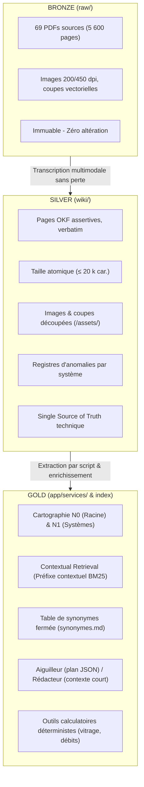

# Plan d'Implémentation — Optimisation du Wiki, Architecture Bronze-Silver-Gold et Qualité de Génération LIA

**Date** : 12 octobre 2026  
**Auteur** : Assistant IA & Elie Lecas  
**Statut** : Proposition soumise à validation (Go / No-Go par phase)  
**Objectif** : Transformer un taux de récupération solide (90%+) en un taux de génération équivalent (≥ 90% de réponses exactes, concises, sans hallucination ni dérive de calcul), tout en assainissant les 950+ pages du wiki sans gaspillage de tokens.

---

## 1. Synthèse de l'état des lieux & Diagnostics

### 1.1. Pourquoi la génération flanche malgré une bonne récupération
Les audits récents (`docs/plan_etape3_generation_2026-10-02.md` et `docs/plan_cartographie_recherche_2026-10-11.md`) ont isolé les causes racines :
1. **Dilution d'attention (*Context Rot* & Distracteurs)** : L'index plat de 940 entrées pèse ~131 000 tokens dans le prompt permanent. En fin de tour, le modèle est saturé de données parasites et confond les gammes jumelles.
2. **Lecture de tableaux orphelins (Défaut D1)** : Le modèle lit les cellules de cotes sans charger la légende ou le paragraphe de calcul (ex. déduction dormant 38 mm vs 74 mm).
3. **Erreurs d'arithmétique (Défaut D2)** : Sommes de vitrages ou soustractions de feuillures erronées (ex. `4/12/4/12/4 = 32 mm` au lieu de 36 mm).
4. **Bruit des anomalies géantes (Défaut D4)** : Injection serveur indiscriminée de dizaines d'anomalies d'une page, dont 90% ne concernent pas la grandeur demandée.
5. **Calibrage du verdict (Défaut D3)** : « Oui » affirmatif précipité sur les faisabilités sans vérification de toute la chaîne de contraintes (DTA, abaque d'ouvrant, limite de vitrage, ferrure, poids).

### 1.2. État du Wiki et des métadonnées
- **Contenu brut** : Remarquable (5 600 pages de PDF retranscrites de façon multimodale native, schémas découpés, 0 perte de données).
- **Structure** :
  - **28 pages monstres > 50 000 caractères** (Roto NX = 125 k, Système 70 = 85 k, Glossaire = 75 k), violant la règle « une donnée = une page » (cible ≤ 15-20 k car.).
  - **3 registres d'anomalies géants** totalisant 1,64 million de caractères (10% du wiki !), mélangeant toutes les gammes.
  - **Métadonnées sous-exploitées** : `tags` inutilisés par le moteur de recherche ; `type` désactivé ; `fournisseur` incohérent ; `descriptions` purement passives au lieu d'aiguiller vers les questions tranchées.

---

## 2. Architecture Cible : Le Modèle Médaillon (Bronze - Silver - Gold)



### Définition des couches :
1. **Bronze (`raw/`)** : Sources primaires intangibles. Jamais d'extraction de texte brute ni d'OCR destructeur.
2. **Silver (`wiki/`)** : La vérité terrain documentaire. Conforme OKF, aucune distillation ni simplification réductrice. Découpé en pages de taille unitaire (≤ 20 000 car.).
3. **Gold (Couche de Navigation et d'Intelligence)** :
   - **Cartographie hiérarchique** : Générée automatiquement depuis la frontmatter, évitant la saturation du prompt.
   - **Contextual Retrieval lexical** : Sections de texte enrichies à l'indexation de leur fil d'Ariane hiérarchique.
   - **Garde-fous déterministes** : Outils de calcul serveur pour soulager le LLM.

---

## 3. Architecture d'Exécution : Le Tour à Deux Rôles

Pour supprimer définitivement le *Context Rot* et maximiser la précision :

```
Question Utilisateur
       │
       ▼
[AIGUILLEUR] (GLM 5.3, Carte N0 + N1 en cache permanent)
       │  - Interprète : Produit, type de valeur, ambiguïtés
       │  - Si ambiguïté bloquante → 1 question de clarification
       │  - Sinon → Rend un Plan de Lecture JSON : [{page, sections, motif}]
       ▼
[SERVEUR LIA] (Exécution déterministe, 0 token LLM)
       │  - Charge exactement les sections demandées (avec leurs légendes associées)
       │  - Filtre chirurgical des anomalies (uniquement celles liées à la grandeur citée)
       ▼
[RÉDACTEUR] (Même modèle, Contexte court : Question + Preuves livrées + Anomalies ciblées)
       │  - Aucun index plat dans le prompt (réduction de 130 k à < 10 k tokens)
       │  - Consigne « Décision d'abord » : Réponse en ligne 1, calculs écrits, pas de blabla
       ▼
Réponse finale sourcée et validée
```

---

## 4. Feuille de Route Opérationnelle (4 Phases)

### Phase 0 — Le Thermomètre (Banc de Mesure Stratifié)
> **Principe** : Rien n'est modifié dans le code ni dans le wiki sans avoir photographié la performance de départ.

1. **Construction du banc de ~140 questions (7 niveaux × 20 questions)** :
   - **N1** : Référence exacte / une page (ex. *« À quoi sert TGY3731 ? »*).
   - **N2** : Cellule d'un grand tableau (ex. *« Parclose SOLEAL FY pour vitrage 28 mm, joint intérieur 4 ? »*).
   - **N3** : Orientation générale / gamme (ex. *« Quels coulissants alu propose-t-on ? »*).
   - **N4** : Multi-pages d'un même système (Profilé → Quincaillerie → Cote de débit).
   - **N5** : Multi-documents / comparaison (ex. *« Différence de drainage entre FY et ASKEY OC ? »*).
   - **N6** : Contradictions & Anomalies (Présence obligatoire de CTR / INC avec les deux valeurs).
   - **N7** : Faisabilité, fausse prémisse, absence (Vérification complète de la chaîne, refus justifié).
2. **Mesures initiales** :
   - (a) **Mesure hors-ligne** (rappel page, rappel section, volume caractères).
   - (b) **Mesure modèle** (taux d'exactitude, fautes graves, hallucinations, coût, longueur).
   - (c) **Témoin Oracle** (le modèle reçoit directement la preuve parfaite pour mesurer le plafond d'exactitude possible du modèle).

*Livrable* : Tableau de bord initial chiffré.  
*Jalon Go / No-Go 0* : Validation par Elie des métriques cibles.

---

### Phase 1 — Assainissement du Silver (Wiki & Métadonnées)
> **Principe** : Zéro lecture massive inutile de 950 pages par Claude. Un script Python déterministe d'abord, Claude ciblé sur les points durs ensuite.

1. **Linter déterministe automatique (`app/scripts/lint_wiki_strict.py`)** :
   - Vérifie la conformité OKF, les liens orphelins, les cibles fantômes.
   - Détecte toutes les pages > 20 000 caractères.
   - Normalise automatiquement la facette `fournisseur` (`profine` → `KÖMMERLING`, etc.).
   - Coût : 0 token, exécution en 3 secondes.
2. **Découpage des 28 pages géantes (> 50 000 car.)** :
   - Priorité 1 : `quincaillerie/roto-nx.md` (125 k car.) découpé par sous-familles (crémones, compas, paumelles, gâches).
   - Priorité 2 : Les 3 pages du Système 70 (85 k car.).
   - Priorité 3 : `reference/glossaire.md` (74 k car.) scindé par fournisseurs/systèmes.
   - Chaque nouvelle page doit être ≤ 15 000 car. et autonome.
3. **Éclatement des 3 registres d'anomalies (1,64 M car.)** :
   - Scinder en fichiers par système : `anomalies/systeme-76-contradictions.md`, `anomalies/technal-incoherences.md`, etc.
   - Conserver rigoureusement les identifiants existants (`INC-xxx`, `CTR-xxx`, `VER-xxx`).
4. **Table fermée des synonymes métier (`wiki_llm/wiki/reference/synonymes.md`)** :
   - Normaliser les variantes : `vantaux` ↔ `vantail`, `OC` ↔ `ouvrant caché`, `DFO` ↔ `dormant`, etc.
5. **Réécriture des descriptions en « Questions tranchées » (Lot W)** :
   - Remplacer les résumés passifs par ce que la page décide (ex. *« Détermine la parclose et le joint pour vitrage 24 à 48 mm sur ouvrant 76281 »*).
   - Réalisé par tranches de systèmes (commencer par Système 76 et SOLEAL).

*Livrable* : Wiki 100% conforme, 0 page > 25 k car., anomalies compartimentées.  
*Jalon Go / No-Go 1* : Rejeu du banc hors-ligne (mesure du gain BM25 grâce aux descriptions et synonymes).

---

### Phase 2 — Mise en place de la Couche Gold (Navigation & Contextualisation)
> **Principe** : Génération de la cartographie par code et enrichissement contextuel sans toucher au texte source.

1. **Générateur automatique de la carte hiérarchique à 3 niveaux** :
   - **Niveau 0 (Racine)** : ~3 000 tokens. Arbre compact Fournisseurs → Systèmes/Gammes → Familles.
   - **Niveau 1 (Sommaire par Système)** : 5 à 15 k tokens par système. Pages regroupées par famille avec leurs descriptions « questions tranchées ».
   - **Niveau 2 (Page / Sections)** : Fiche de la page + sommaire des sections (déjà géré dans `lire`).
   - Remplacement de l'immense `index.md` dans le prompt de LIA par le Niveau 0.
2. **Contextual Retrieval lexical (sans vecteurs)** :
   - À l'indexation dans `wiki_index.py`, chaque section reçoit un préfixe textuel calculé :
     `[Système · Famille · Titre de Page · Titre de Section · En-tête Tableau]`.
   - Divise par deux les faux positifs sur les termes génériques (« largeur maxi », « vis »).
3. **Calculateur déterministe côté serveur (Arithmétique sécurisée)** :
   - Étendre `faisabilite.lire_vitrage` : décomposition automatique des compositions de vitrage (ex. `4/16/4` → total 24 mm, verre cumulé 8 mm) directement injectée dans la fiche de la question.

*Livrable* : Index hiérarchique dynamique et sections enrichies.  
*Jalon Go / No-Go 2* : Vérification que le préfixe de contexte ne dégrade aucune recherche de référence exacte (N1).

---

### Phase 3 — Découplage Aiguilleur / Rédacteur & Consignes de Génération
> **Principe** : Alléger le contexte du rédacteur et verrouiller le calibrage des réponses.

1. **Découplage des deux rôles dans `wiki_chat_service.py`** :
   - L'Aiguilleur reçoit la carte et génère le plan de lecture.
   - Le serveur lit les sections et filtre drastiquement les anomalies (`match_anomalies` ne retient qu'une anomalie citant explicitement la pièce ou la cote concernée).
   - Le Rédacteur est appelé sur un contexte court (< 10 k tokens) sans l'index permanent.
2. **Verrouillage des consignes du Rédacteur (`app/prompts/wiki_consignes.md`)** :
   - **Décision d'abord** : Réponse ou verdict dès la première phrase.
   - **Calcul explicite obligatoire** : Toute dimension déduite doit écrire sa formule (`1 300 - 2 × 38 = 1 224 mm`).
   - **Calibrage de faisabilité** : Interdiction du « Oui » catégorique sans validation de la chaîne complète. Repli sur « Oui sous réserve de... » ou « Non en l'état ».
   - **Silence sur l'inutile** : Interdiction de citer les anomalies hors sujet ou d'inventer des explications physiques.

*Livrable* : Tour de chat refondu et prompt épuré.  
*Jalon Go / No-Go 3* : Évaluation comparative sur le banc de 140 questions contre le témoin Oracle.

---

### Phase 4 — Industrialisation & Boucle Qualité Permanente
1. **Intégration CI/CD** :
   - Le linter strict tourne sur chaque dépôt de wiki (`/admin` ou commit).
   - Alerte bloquante si une page créée dépasse 20 000 caractères ou manque de facette obligatoire (`famille`).
2. **Boucle de rétroaction des échecs** :
   - Toute question réelle d'atelier en échec est transformée en cas de test dans le banc golden.
   - Règle d'or : **Une erreur se corrige d'abord dans le wiki (Silver), jamais en complexifiant le prompt.**

---

## 5. Tableau Récapitulatif : Coûts, Risques & Gains Attendus

| Phase | Action Principale | Coût Jetons / API | Risque | Gain Attendu |
|---|---|---|---|---|
| **Phase 0** | Banc de test 140 questions | ~20 $ (passes de mesure) | Aucun (mesure pure) | Visibilité exacte du plafond de qualité (Oracle) |
| **Phase 1** | Linter + Découpe des 28 pages monstres | ~10-15 $ (lots de découpe ciblés) | Régression sur anciens liens | Suppression des pertes de contexte et désengorgement du moteur |
| **Phase 2** | Cartographie Gold & Contextual Retrieval | 0 $ (algorithmique / script) | Sursensibilité lexicale | Élimination de 120 k tokens de bruit dans le prompt permanent |
| **Phase 3** | Découplage Aiguilleur / Rédacteur | 0,02 $ / question en inférence | Transition d'architecture | Disparition des confusions de gammes, calculs fiabilisés, concision |

---

## 6. Décisions requises pour démarrage

1. **Validation de la Phase 0** : Accord pour figer la liste des 140 questions du banc stratifié et exécuter la mesure de départ.
2. **Priorisation du découpage de la Phase 1** : Accord pour traiter en priorité `roto-nx.md` (125 k car.) et le `système 70` (85 k car.).
3. **Adoption du modèle Aiguilleur / Rédacteur** : Validation du principe de séparer la navigation dans la carte de la rédaction finale de la réponse.
